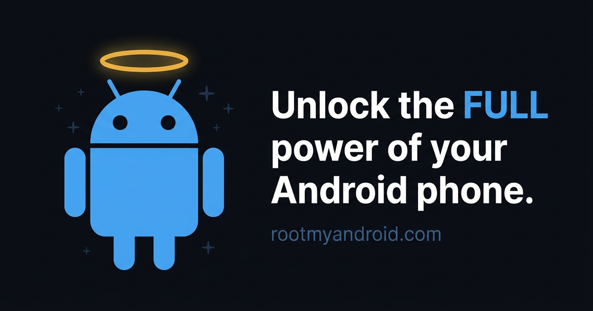

<!-- README.md -->
<p align="center">
  
</p>

# Root My Android

[](https://github.com/nyusternie/rootmyandroid/actions/workflows/web.yml)
[](https://codecov.io/gh/nyusternie/rootmyandroid)
[](LICENSE)

**Analyze any Android in your browser — no installs, no account — and get a
real rooting plan.** Root My Android is open source: the static website, the
mobile apps, and the shared client libraries all live in this public
monorepo. Accounts on the hosted service are Mullvad-style: no email, no
password, just an account number.

**https://rootmyandroid.com**

## Apps

| App | Path | What it is |
| --- | ---- | ---------- |
| **Web** | [`apps/web`](apps/web) | The Astro 7 static site behind rootmyandroid.com — free in-browser device scan (read-only ADB over WebUSB), guides library, product profiles, and the account portal. Content pages ship zero JavaScript. |
| **Root My Android** (Android) | [`apps/android`](apps/android) | Device scan, paired Guardian Angel devices, encrypted backups, and tools (React Native 0.88, `com.rootmyandroid`). Backups are encrypted client-side with a user-held key — the API only ever sees ciphertext. |
| **Root My Android** (iOS) | [`apps/ios`](apps/ios) | The iOS monitoring edition (React Native 0.88, `com.rootmyandroid`). |
| **Rootz** | [`apps/rootz`](apps/rootz) | Plain Gradle/Kotlin app (`com.rootmyandroid.rootz`): wireless-ADB pairing (mDNS + SPAKE2), TLS connect, and in-app shell — complete 2026-11-09, measured on blueline (Pixel 3, Android 12); `v26.11.8`. The no-wipe tier product. Next milestone: linking devices to Root My Android account numbers. |
| **Rootz daemon** | [`apps/rootzd`](apps/rootzd) | Rust daemon that runs on a rooted Android device (also runs at shell tier); the Rootz Pro professional tools (Terminal Editor, Log Analysis) attach here. Deployed and verified on the redfin test rig. |
| **Guardian Angel** (Android) | [`apps/guardian-angel`](apps/guardian-angel) | Parental-control companion that runs in the background on the managed device and syncs to a Root My Android account (React Native 0.88, `com.rootmyandroid.guardian_angel`). Uninstall protection via the device-administrator API. |
| **Shared client** | [`packages/shared`](packages/shared) | Theme + typed `/v1` API client shared by the mobile apps (TypeScript source, no build step). |

## How it works

1. **Scan free** — plug an Android into a WebUSB-capable desktop browser and
   analyze it entirely client-side. Read-only: `getprop` and inspection
   commands only, nothing leaves the browser unless you explicitly save the
   report to an account.
2. **Create an account** — random account number, no email, no personal data.
3. **Pair a device** — install Guardian Angel on the managed device and sync
   it to the account, or open the Root My Android app for device scan, paired devices,
   encrypted backups, and tools.

## Products & pricing

Top-ups are prepaid, Mullvad-style: add time anytime, no auto-renewal, no
stored card. Crypto payments get 15% off the subscription plans below.

| Product | Plan | Price | Period |
| ------- | ---- | ----- | ------ |
| — (free core: in-browser scan + rooting plan) | Free | $0 | — |
| Guardian Angel (up to 5 devices per account) | Lite | $5 | 30 days |
| Guardian Angel (up to 5 devices per account) | Pro | $15 | 30 days |
| Rootz (Terminal Editor, Log Analysis) | Pro | $15 | 365 days |

## Architecture

- **`apps/web`** — purely static **Astro 7** site, deployed to Cloudflare
  Pages. Content pages ship zero JavaScript; vanilla TS modules on the app
  pages talk to the API at `rootmyandroid.com/v1`.
- **`rootmyandroid-api`** (sibling repo) — the Cloudflare Worker serving
  `/v1`: accounts, account ledger, audits, first-party analytics.
- **`rootmyandroid-admin`** (sibling repo) — the analytics dashboard.
- **`apps/android` / `apps/ios` / `apps/guardian-angel`** — React Native 0.88 apps
  (Root My Android Android utility, iOS monitoring edition, Guardian Angel).
- **`apps/rootz`** — the Rootz app (plain Gradle/Kotlin; wireless-ADB client,
  rootzd bridge client for su tiers).
- **`apps/rootzd`** — the Rootz daemon (Rust, rooted Android devices; deployed
  and verified on the redfin test rig, shipped as a Magisk module zip).
- **`packages/shared`** — theme + typed `/v1` API client shared by the apps.

Analytics are first-party only (`/v1/analytics/*`); there is intentionally no
third-party tracking.

## Repository layout (pnpm workspace)

```
/
├── apps/
│   ├── web/          # Astro 7 static site (this README's banner lives in
│   │                 # apps/web/public/og-image.png)
│   ├── android/      # Root My Android (Android edition): RN 0.88 app
│   ├── ios/          # RootMyAndroid (iOS monitoring edition): RN 0.88 app
│   ├── guardian-angel/ # React Native 0.88 app (com.rootmyandroid.guardian_angel)
│   ├── rootz/        # Rootz app: plain Gradle/Kotlin wireless-ADB + shell client
│   └── rootzd/       # Rootz daemon: Rust, rooted Android devices
├── packages/
│   └── shared/       # rootmyandroid-shared — theme + typed /v1 API client
├── .agents/skills/   # Project agent skills (brand-image: brand canon)
├── .vendor/          # Vendored tarballs (hermes-compiler; see pnpm-workspace.yaml)
├── .github/workflows/    # web.yml (web CI + Pages deploy gate),
│                       # android-preview.yml, rootz.yml, rootzd.yml
├── pnpm-workspace.yaml
└── package.json      # root scripts only; private, no publish
```

## Development

| Task            | Command                    |
| --------------- | -------------------------- |
| Install         | `pnpm install`             |
| Dev server      | `pnpm dev`                 |
| Type-check      | `pnpm check`               |
| Test (all pkgs) | `pnpm test`                |
| Build (static)  | `pnpm build`               |

**Tests gate deploys.** Every push to `master` runs check → test:coverage →
build in CI, uploads lcov to Codecov (flag `web`), and only then deploys
`apps/web/dist` to Cloudflare Pages. pnpm 11.x, Node ≥ 18.17 (CI uses 22).
All dependencies are pinned to exact versions (CI-enforced).

**Versioning is date-based, `YY.M.D`** (e.g. `v26.11.10`), bumped at each
release across every package in the monorepo; Android `versionCode` integers
keep incrementing independently. Mobile builds ship as rolling GitHub
prereleases (`preview-apk`, `rootz-preview-apk`, `rootzd-preview`).

## Brand

Three Android-green characters, defined in
[`.agents/skills/brand-image/`](.agents/skills/brand-image/SKILL.md) (read it
before any image task):

| Character | Fronts |
| --------- | ------ |
| **SU superhero** (cape + SU diamond shield) | Root My Android — OG card, landing hero, favicons |
| **Guardian Angel** (halo) | The monitoring product |
| **Colonel Su** (beard, glasses, monk robe, SU-staff) | The Rootz Pro professional-tools product |

## Docs

- [HANDOFF.md](HANDOFF.md) — historical decision log: the Nitro→Halo
  rebrand handoff and the pricing history through the 2026-11-05 top-up
  model
- [AGENTS.md](AGENTS.md) — standing working rules for contributors and AI
  agents (current authority)
- [`apps/rootz/docs/`](apps/rootz/docs) — wireless-debugging setup guide
  (pairing + connect phases, measured on blueline)
- [`apps/rootzd/docs/`](apps/rootzd/docs) — daemon engineering log: test
  devices, e2e protocol, redfin unlock sessions, relay API handoffs

## License

[MIT](LICENSE) © 2026 Root My Android LLC.
