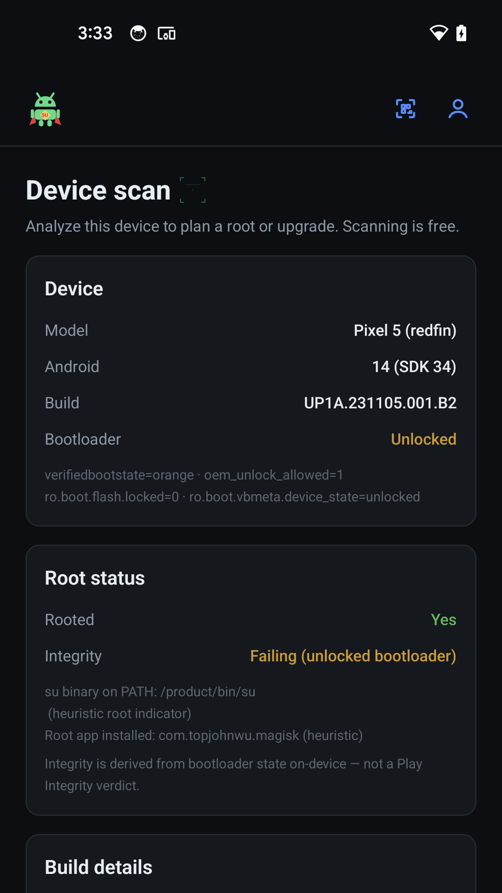
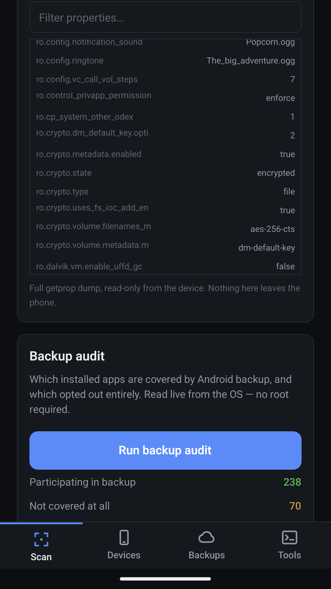
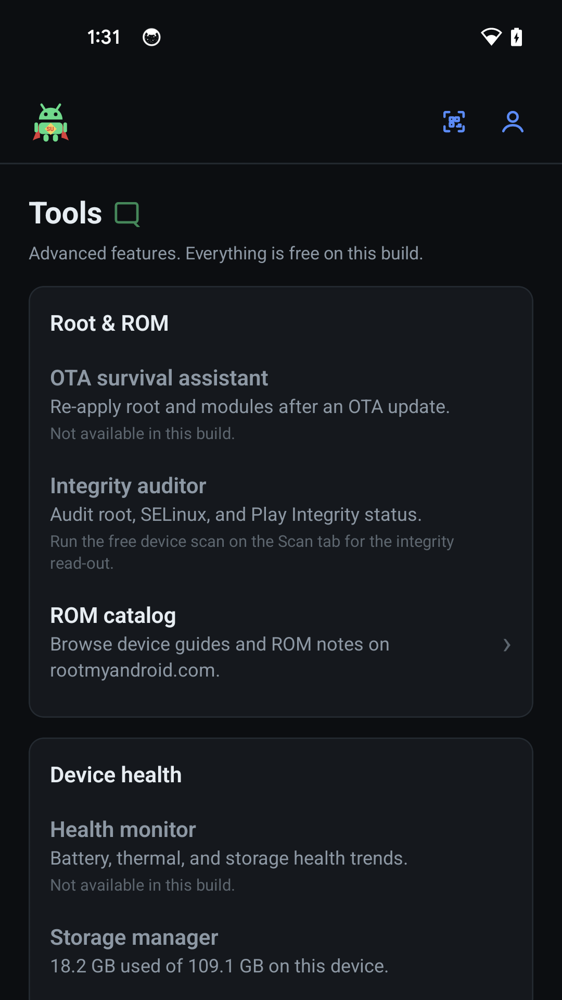
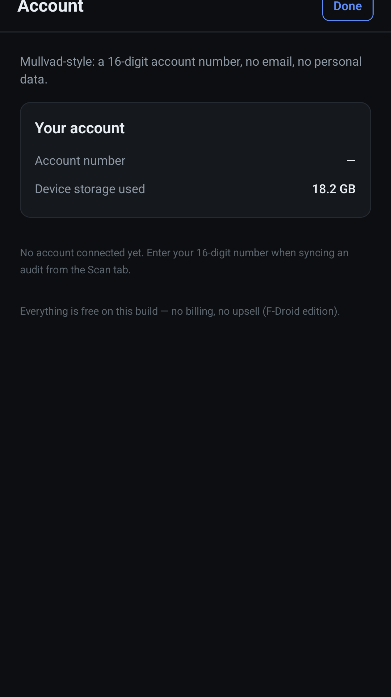

## Abstract for new app inclusion

### Please introduce the functions and usage of your app in summary, and also attach some screenshots.

**Root My Android** is a read-only device audit for Android. It answers one
question with evidence instead of guesses: *what stands between this phone
and root?*

**Usage.** Open the app, tap **Run scan**. It reads the device's real
properties from the system (`getprop`: build fingerprint, bootloader and
verification state, SELinux mode) plus the root-side facts — where `su`
exists on the device (a `command -v su` PATH lookup, never an execution)
and which root-management packages are installed. A rules engine grades
what it finds (bootloader state, root present or absent, integrity) and
shows the raw properties behind every line in a searchable list. Values
the device does not report render as `unknown`.

A second, equally read-only **backup audit** reads from the OS whether each
installed app allows its data into Android's auto-backup, and summarizes
how much of the backup set is actually participating, listing the apps
that opted out.

Beyond the audits: **encrypted backups** (the snapshot is encrypted on the
device with an AES-256-GCM key held in the Android Keystore before upload —
the server only ever receives ciphertext), **QR pairing** (a scanned code
is stored on the phone, nothing uploaded), and **Tools** (live battery
state, real StatFS storage figures, and links to the rooting, bootloader
and logcat guides).

No account is needed for any of the audits. An account — a 16-digit number,
no email, no personal data — is only used if the user chooses to sync an
audit or store a backup.

Screenshots (all captured from the F-Droid build on a Pixel 5, Android 14).
All eight are committed upstream in
[`fastlane/metadata/android/en-US/phoneScreenshots/`](https://github.com/nyusternie/rootmyandroid/tree/v26.11.28/fastlane/metadata/android/en-US/phoneScreenshots)
— the same files F-Droid imports for the listing:

**Scan results — real device facts, graded root status**

**Backup audit — live participation counts**

**Tools — live battery, real StatFS storage, guide links**

**Account — number-only, no email**

### Please elaborate why you wrote this app. Please highlight the unique functions it provides over other similar apps in F-Droid.

I wrote it because every "root checker" on Android tells you *whether* you
are rooted and nothing about *why* — and none of them tell you the thing
that actually bites people: which of your installed apps quietly excluded
themselves from Android's backup, so your authenticator or messenger is not
in the backup you are counting on.

What is unique here:

- **Evidence, not a verdict.** The scan shows the raw `getprop` values
  behind every graded line, so a user can verify the conclusion instead of
  trusting a badge.
- **The backup audit.** I have not found another F-Droid app that reports
  per-app auto-backup participation from the OS (corrections welcome — that
  would be worth knowing). It is read-only and needs no root.
- **Strictly read-only by design.** The app never flashes, never writes,
  never requests root for itself, and never touches other apps' data. This
  is enforced in code (`command -v su` only) and was verified on a rooted
  Pixel 5: no `su` prompt is ever raised during a scan.
- **No tracking.** No analytics, no crash reporting, no advertising or
  tracking SDK. The only network destination is `rootmyandroid.com`, and
  only when the user presses a sync or backup button.
- **Mullvad-style account**: a 16-digit number, no email, no personal data.

## Checklist

### Policy

* [x] The app complies with the [inclusion policy](https://f-droid.org/docs/Inclusion_Policy). _Pay special attention to Quality point 6._
  * Unique value (Quality point 6): the evidence-first root scan and the per-app backup audit described above are not offered by comparable F-Droid apps. Not a rebrand or a fork.
  * The project has been under active development since 2022-12 (370 commits at this commit); the Android edition ships regular tagged releases (current: `v26.11.28`).
* [x] The original app author has been notified (and does not oppose the inclusion). If you are not the author, please paste the link of the reply from the author.
  * I am the author and copyright holder (MIT).
* [x] The upstream app source code repo contains the app metadata in a [Fastlane](https://gitlab.com/snippets/1895688) or [Triple-T](https://gitlab.com/snippets/1901490) folder structure. The summary and description must be included and images, icon, and changelog should also be provided for better user experience. The `en-US` locale must be included.
  * Upstream: https://github.com/nyusternie/rootmyandroid — `fastlane/metadata/android/en-US/` with `title.txt`, `short_description.txt`, `full_description.txt`, `images/icon.png`, `phoneScreenshots/` (8 screenshots) and `changelogs/20261126.txt`. The same title/summary/description/icon also exist in the Triple-T layout at `apps/android/android/app/src/fdroid/play/listings/en-US/`.

### Docs

* [x] Please read [the guide](https://gitlab.com/fdroid/fdroiddata/-/blob/master/CONTRIBUTING.md) first if this is your first contribution.
* [x] Please make sure your metadata follows the best practice in [our templates](https://gitlab.com/fdroid/fdroiddata/tree/master/templates).
* [x] Please read the [Build Metadata Reference](https://f-droid.org/docs/Build_Metadata_Reference/) and make sure your metadata is valid.
* [x] Please read the [Quick Start Guide](https://f-droid.org/en/docs/Submitting_to_F-Droid_Quick_Start_Guide/).

### Merge Request Setup

* [x] The title of this merge request should follow "New app: app name" format.
  * `New app: Root My Android`
* [x] Please make sure your fdroiddata fork is public and your branch is not protected. See <https://docs.gitlab.com/user/project/repository/branches/protected/>.
  * Fork `nyusternie/fdroiddata` is public; branch `com.rootmyandroid` is not protected.
* [x] Please read [our Git guide](https://gitlab.com/fdroid/wiki/-/wikis/Tips-for-fdroiddata-contributors/Git-Usage) if you don't know how to rebase your branch. Don't rebase your branch if there is no conflict.
* [x] All related [fdroiddata](https://gitlab.com/fdroid/fdroiddata/issues) and [RFP issues](https://gitlab.com/fdroid/rfp/issues) have been referenced in this merge request
  * No RFP issue: this is submitted by the app's author.
* [x] Please only submit one app in one MR.
  * One app: `com.rootmyandroid`.

### Metadata

* [x] Metadata must be put in `metadata/<applicationId>.yml`.
  * `metadata/com.rootmyandroid.yml`
* [x] Metadata must be a valid YAML file.
* [x] Metadata must use LF as line ending.
* [x] Don't add summary/description/changelog/images or anything that should be provided in upstream repo. Please check the Changes tab to make sure there is no other unrelated files added in the MR.
  * The MR adds exactly one file: `metadata/com.rootmyandroid.yml`. All store metadata lives in the upstream repo (see Policy above).
* [x] Releases are tagged and auto update is enabled unless there is a special reason.
  * `AutoUpdateMode: Version`, `UpdateCheckMode: Tags`; releases are tagged `v<YY.M.D>` and each publishes `app-fdroid-release.apk`.
* [x] There is an issue tracker and contact info of the author so that we can report bugs and contact the author.
  * Issue tracker: https://github.com/nyusternie/rootmyandroid/issues (also `AuthorName` and `WebSite` in the metadata).
* [x] An AuthorName must be added. It doesn't need to be the real name.
  * `AuthorName: Root My Android contributors`
* [x] External repos are added as git submodules instead of srclibs. You can update git submodules without opening an MR in this repo and the submodule is covered by our scanner.
  * No external repos; no srclibs.
* [x] Enable [Reproducible Builds](https://f-droid.org/docs/Reproducible_Builds). We'll use your signature for improved security/reliability, also allowing users to switch between different channels. Do note that if you don't enable reproducible build then the apk will be signed with our key so you can't enable it later. If you can't enable this, please add the reasons here.
  * Enabled, upstream-signed: `Binaries:` + `AllowedAPKSigningKeys:` (our upload key, cert SHA-256 `1c59c4331c9c8f1fc0e41578ef47ac404396ba7596f5a4c8e94528d4886bceca`). The `fdroid build` job rebuilds the app from source and then runs `fdroid publish --error-on-failed`, which compares the result byte-for-byte against the hosted reference binary and ships our APK only on a match. The same recipe — identical apart from the version fields — passed that comparison in the previous MR's pipeline (`compared built binary to supplied reference binary successfully`; `supplied reference binary has allowed signer 1c59c433…`).
* [x] Setup abi split if the APK is large and the splitted ones can be much smaller.
  * Not needed: the APK is 17,993,664 bytes (~18 MB) with `arm64-v8a` + `armeabi-v7a` only (`reactNativeArchitectures` limits the build; the x86 emulator images are not packaged).
* [x] Only the latest versions should be kept in the metadata before it's merged. If you update the metadata, please replace the old versions with the new ones.
  * A single `Builds:` entry: 26.11.28 / 20261128.
* [x] Don't add any disabled versions in the metadata.
* [x] The `commit` field should be the full hash. Please don't use tag or branch in commit.
  * `commit: 0d30c05f37d0e9139b78724802b174471227858b`

### Pipeline

* [x] All pipelines should pass.
* [x] All warnings and errors in the Reports tab should be fixed or explained.
  * The codequality report is entirely `info`/`minor`, and every entry is expected:
    * `Permission android.permission.INTERNET` — optional audit sync and encrypted backup upload to `https://rootmyandroid.com/v1` (see the NonFreeNet anti-feature). Nothing is sent during a scan.
    * `Permission android.permission.QUERY_ALL_PACKAGES` — the read-only backup audit reads every installed app's `FLAG_ALLOW_BACKUP`, and the scan detects installed root-management packages. No package data leaves the device.
    * `Permission android.permission.CAMERA` — QR pairing only; decoding is local (ZXing), frames never leave the device.
    * `Permission com.rootmyandroid.DYNAMIC_RECEIVER_NOT_EXPORTED_PERMISSION` — React Native's own signature-level permission for non-exported broadcast receivers (comes with the RN template); it grants nothing to other apps.
    * `APK has no R8 Marker` — R8 is not used: the React Native release build sets `enableProguardInReleaseBuilds = false` and ships JS as Hermes bytecode.
    * `APK ABI and size: arm64-v8a (12M) armeabi-v7a (11M), 18M` and `Signing Key: CN=Root My Android Upload` — informational: the two packaged ABIs, and the upload key that `AllowedAPKSigningKeys` pins.
* [x] F-Droid CI runners are under GitLab's FOSS program, so there's no need for you to pay for any CI time. If Gitlab starts asking for phone numbers or credit cards don't submit anything, just leave a note in the MR so we know we need to trigger the CI.

Supersedes !58356, which was closed because the MR template was not followed.
This MR uses the template structure and changes exactly one file:
`metadata/com.rootmyandroid.yml`.

/label ~"New App"
